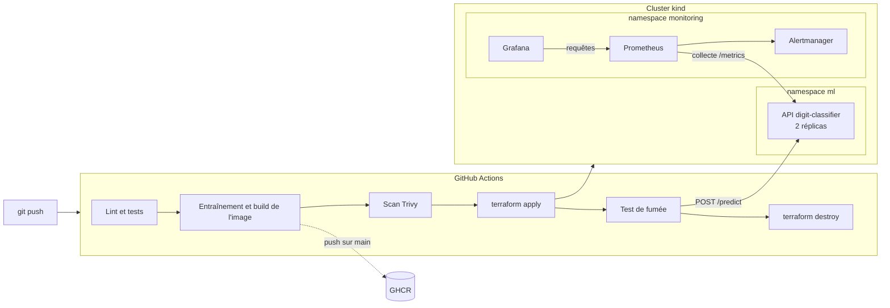

# Déployer un modèle d'IA sur Kubernetes avec Terraform

[](https://github.com/yannisbououdine-cpu/mlops-kubernetes-terraform/actions/workflows/ci.yml)

Un modèle de reconnaissance de chiffres manuscrits, servi par une API, déployé sur Kubernetes par Terraform, supervisé par Prometheus et Grafana, et **réellement déployé puis testé à chaque commit** par la CI.

Le modèle est volontairement simple : le sujet du projet est tout ce qui l'entoure, c'est-à-dire la chaîne qui le mène en production et le surveille une fois qu'il y est.

## Ce que le projet montre

| Compétence | Où la voir |
|---|---|
| Infrastructure as Code | [`terraform/`](terraform) crée le cluster, installe la supervision et déploie l'API en un seul `terraform apply` |
| Kubernetes | [`chart/`](chart) : chart Helm avec conteneur non-root, système de fichiers en lecture seule, sondes et mise à jour sans coupure |
| CI/CD | [`.github/workflows/ci.yml`](.github/workflows/ci.yml) : lint, tests, scans de sécurité, déploiement de bout en bout, publication de l'image |
| Observabilité | Métriques applicatives et métier, tableau de bord et 4 alertes versionnés avec le code |
| MLOps | Seuil de qualité qui bloque une image si le modèle est moins bon, version du modèle traçable jusqu'au commit |
| Sécurité de la chaîne | Actions épinglées par SHA, versions figées, scans Trivy, droits minimaux, aucun secret dans le dépôt |

## Architecture



Terraform crée trois choses dans l'ordre :

1. un cluster **kind** (Kubernetes dans Docker), avec l'image de l'API chargée dans le nœud ;
2. **kube-prometheus-stack** : Prometheus, Alertmanager et Grafana ;
3. l'**API**, via le chart Helm du dépôt. Ce chart apporte aussi ce qui la supervise : la cible de collecte (ServiceMonitor), les alertes (PrometheusRule) et le tableau de bord Grafana.

## Démarrage rapide

Prérequis : Docker, Terraform 1.17, `make`, `curl` et `jq`. Python 3.13 pour les tests et le générateur de trafic.

```bash
make up      # entraîne le modèle, construit l'image, crée le cluster et déploie tout (~5 min)
make smoke   # vérifie le déploiement de bout en bout
```

Puis :

```bash
curl -X POST http://127.0.0.1:8080/predict \
  -H 'Content-Type: application/json' -d @examples/digit-5.json
# {"digit":5,"confidence":0.918,"model_version":"a1b2c3d"}
```

| Service | Adresse | Accès |
|---|---|---|
| API | http://127.0.0.1:8080 | `/predict`, `/model`, `/healthz`, `/metrics`, documentation sur `/docs` |
| Grafana | http://127.0.0.1:3000 | `admin` / `terraform -chdir=terraform output -raw grafana_admin_password` |
| Prometheus | http://127.0.0.1:9090 | onglet *Alerts* pour l'état des règles |

```bash
make traffic   # trafic normal : le tableau de bord se remplit
make drift     # images bruitées : l'alerte de dérive se déclenche en ~15 min
make down      # détruit le cluster et tout ce qu'il contient
```

## Ce que fait la CI

À chaque pull request et à chaque push sur `main` :

| Job | Étapes | Ce qui fait échouer |
|---|---|---|
| **API** | `ruff`, `pytest` | Une erreur de lint, un test rouge, un modèle sous 95 % d'exactitude |
| **Infrastructure** | `hadolint`, `actionlint`, `helm lint`, `terraform fmt` et `validate`, Trivy sur l'IaC | Une mauvaise configuration HIGH ou CRITICAL |
| **Bout en bout** | Build de l'image (qui entraîne le modèle), Trivy sur l'image, `terraform plan` puis `apply` sur un vrai cluster kind, test de fumée, `terraform destroy` | Une vulnérabilité corrigeable HIGH ou CRITICAL, un déploiement qui ne converge pas, un test de fumée en échec |

Le test de fumée ([`scripts/smoke-test.sh`](scripts/smoke-test.sh)) ne se contente pas d'appeler l'API : il vérifie aussi que Prometheus collecte les deux pods, que les quatre alertes sont chargées et que Grafana a provisionné le tableau de bord. La supervision est testée comme le reste.

Sur `main`, l'image validée est publiée sur GitHub Container Registry, avec pour tag le commit dont elle est issue. Dependabot propose chaque semaine la mise à jour des actions, des dépendances Python, de l'image de base et des providers Terraform. Chaque proposition passe par cette même CI.

## Supervision

L'API expose deux familles de métriques :

- **techniques** : débit, codes de réponse et latence par route ;
- **métier** : répartition des chiffres prédits, confiance du modèle, exactitude du modèle servi.

| Alerte | Condition | Gravité |
|---|---|---|
| `DigitClassifierDown` | Aucun pod ne répond depuis 2 min | critique |
| `DigitClassifierHighErrorRate` | Plus de 5 % d'erreurs 5xx pendant 5 min | critique |
| `DigitClassifierHighLatency` | 95e centile de `/predict` au-dessus de 250 ms pendant 5 min | avertissement |
| `DigitClassifierPredictionSkew` | Un seul chiffre au-dessus de 25 % des prédictions pendant 15 min | avertissement |

La dernière alerte détecte une dérive des données d'entrée **sans connaître les bonnes réponses**. Le choix de ce signal plutôt que la confiance du modèle, qui paraît plus naturel, repose sur une mesure : voir [docs/decisions.md](docs/decisions.md#6-détecter-la-dérive-par-la-répartition-des-prédictions). Chaque alerte renvoie à sa procédure dans le [runbook](docs/runbook.md).

## Structure du dépôt

```
app/          API FastAPI, entraînement, tests et Dockerfile
chart/        chart Helm : déploiement, service, collecte, alertes, tableau de bord
terraform/    cluster kind, supervision et déploiement de l'API
scripts/      test de fumée et générateur de trafic
examples/     requête d'exemple
docs/         choix techniques et runbook
```

## Passer du poste local au cloud

kind permet de tout tester gratuitement et à chaque commit. Pour un environnement réel, voici ce qui changerait :

| Ici | En production |
|---|---|
| Cluster kind créé par Terraform | Cluster managé (EKS, GKE ou AKS) avec son réseau, dans une configuration Terraform séparée de celle des applications |
| État Terraform local | État distant verrouillé (S3 et DynamoDB, GCS, Azure Storage) |
| Image chargée dans le nœud | Image tirée de GHCR ou d'un registre cloud, référencée par son condensat |
| Services en NodePort | Ingress ou Gateway API avec TLS |
| `terraform apply` lancé par la CI | Argo CD ou Flux qui synchronise le cluster depuis Git |
| 2 réplicas fixes | HorizontalPodAutoscaler et PodDisruptionBudget |
| Alertes visibles dans Alertmanager | Routage vers Slack, e-mail ou un outil d'astreinte |

## Documentation

- [Choix techniques](docs/decisions.md) : chaque décision, ses alternatives et ce qu'elle coûte
- [Runbook](docs/runbook.md) : que faire quand une alerte se déclenche
